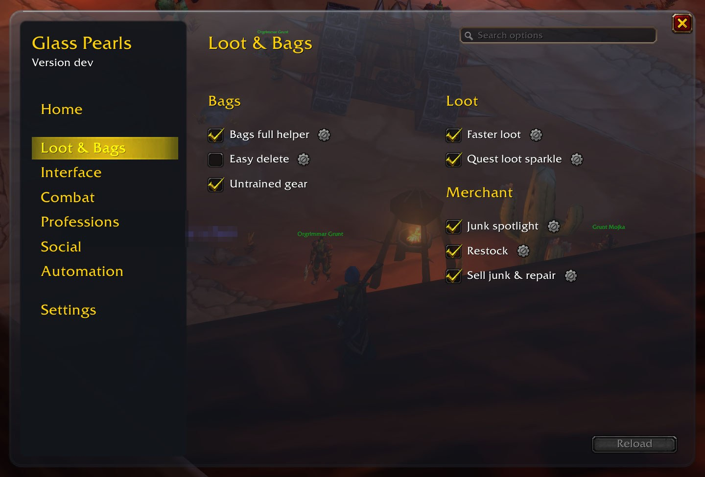
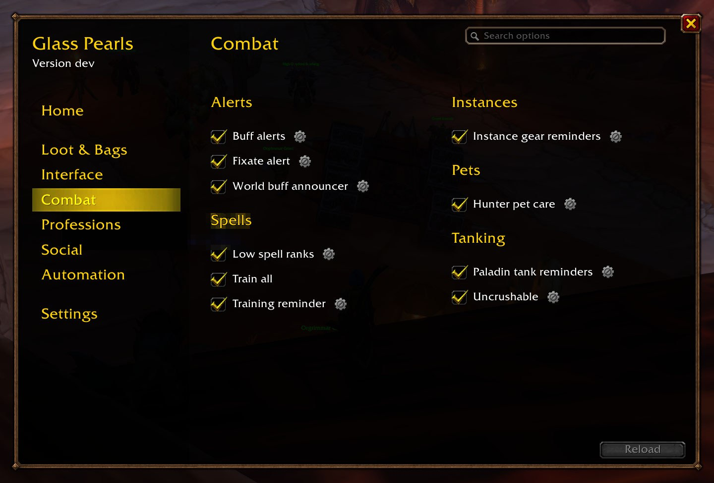
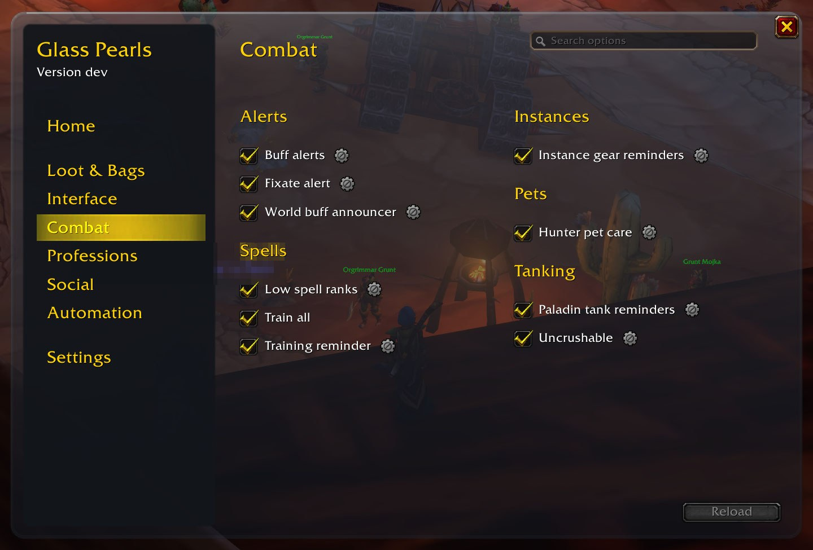
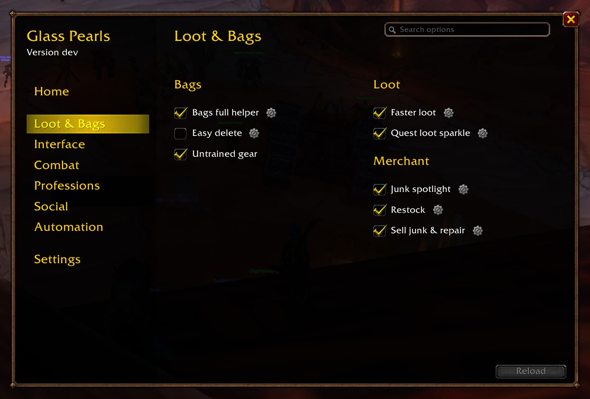
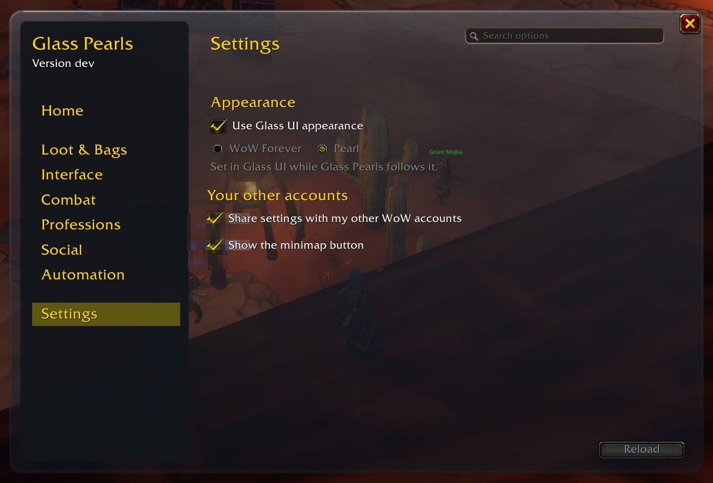

# Glass Pearls

**Thirty-one small things World of Warcraft: Forever should have done for you all along, in one
addon.** Junk sold and gear repaired the moment you open a merchant. Bags that never block your
loot. A trainer that tells you what's new when you level. Library books, dungeon doors and boats on
your map, and a compass along any `/way` route you paste. Bars that tell you when your sleeping bag and campfire are done with you. Fishing without hunting for the bobber. A raid mark wheel at your cursor. And many more.

Each one is a **pearl**: a small, independent feature with its own switch. Keep the ones you love,
turn off the rest. Your choices follow you to every one of your own WoW accounts.

## Why you'll like it

- **One window for everything.** `/gpearls`, or the pearl on your minimap. Every feature has a
  checkbox and a gear for its options, and a search box finds any of them.
- **Quiet by default.** Pearls that act for you in ways you might not expect start **off**; the
  rest just make the game smoother.
- **Careful.** Nothing is sold, bought, picked or destroyed on a guess: everything is read again
  just before it acts, and it stops when something doesn't add up.
- **Your settings everywhere.** Change something on one account, and your other accounts on the
  same Battle.net account pick it up, even one that was offline.
- **Every client language.** Spells, buffs and items are recognized by their IDs, never their
  English names.
- **Two looks, or Glass UI's.** WoW Forever's own look or Pearl, the Glass family's glass: your
  choice. With [Glass UI](https://github.com/Spotnick2/GlassUI) installed, it follows Glass UI's
  glass, tint and accent, live.

## The pearls

Listed as the options window groups them, with whether each starts on or off.

### Loot & Bags

**Bags full helper** (on). When loot doesn't fit, it offers to destroy the cheapest item in your
bags and loot in one click, right beside the loot window (on its left when "Loot window at cursor"
puts it near the right edge of the screen).
- It only shows when an item really doesn't fit: a partial stack or a matching herb or mining bag
  counts as room. After "Inventory is full" at a node or quest object, it helps you make room.
- It offers grey items (or grey and white, in its options), cheapest first by vendor value times
  stack. Quest items, tools, equipment-set items, consumables, containers, reagents, ammunition,
  recipes, keys and items with a use are never offered. White items need a second click.
- When a white stack is cheaper than the suggestion (a few pieces of bread against a grey worth
  more), it shows under it too, so you can pick it instead.
- `<` `>` browse the suggestions; the X never suggests an item again, on all your characters and
  accounts; quest loot is picked first. When the loot is worth less than anything in your bags it
  says so, and "Choose anyway" is there.

**Faster loot** (on). With auto loot on, everything that will fit in your bags is taken the moment
the loot window opens.
- Bind-on-pickup still asks you; a group's rolls and master loot, and anything that may not fit,
  are left to the game.
- When a corpse has only money, the amount floats up where you clicked (a setting).

**Sell junk & repair** (on). At a merchant, it sells your junk, then repairs, guild funds first
when your guild allows it.
- Grey items with a price, and anything you list with `/gpearls sell` (shift-click the item).
  Never what you list with `/gpearls keep`, quest items, tools, equipment-set items or refundable
  purchases; not unbound grey gear or greys with a use unless listed.
- Cheapest first, one at a time, each checked just before it goes, so the ones you can still buy
  back are the most valuable; "buyback-safe" (in the gear) sells only what the buyback page can
  hold. Hold Shift as you open the merchant to skip a visit.
- A guild whose info says `[noautorepair]` is never charged.

**Restock** (on). At a merchant, after junk is sold, it tops up your food, water (if you use mana),
arrows or bullets (hunters) and class reagents, with the best the merchant has that you can use.
- Only what's at least as good counts toward a target, so you move up as you level.
- At most half your money and 5 gold a visit (both settings). "Ask first" shows the list to
  confirm each time; Shift skips it.
- Below the level cap, a visit with food to buy asks first (or never buys food, or buys it as the
  rest: a setting).

**Junk spotlight** (off). A coin on the bag items Sell junk & repair may sell at the next merchant,
and a tooltip line ("Eligible for automatic sale", with its value, or "Kept: on your keep list").

**Untrained gear** (on). A weapon or armor you can't use only because you haven't learned its skill
yet (a warrior's plate before level 40, a mage's first sword) shows its type in yellow, not red,
with a note in its tooltip: a weapon master teaches weapons, your class trainer armor, and from
which level. Anything else red, and gear your class can never use, stays as it is.

**Equipment set guard** (on). Warns you before you lose an item from one of your Equipment Sets
(the game's own tooltip already names an item's sets).
- Destroying one: the game's confirmation stays, with the set's name in red under it.
- Selling: at a merchant, a set item's tooltip says to take care. If one you right-clicked there
  leaves your bags, you're told to buy it back from the Buyback tab (dragging an item onto the
  merchant isn't noticed).
- Disenchanting: during the cast you're told which set item it may be on, so you can move or press
  Esc to stop it.
- An addon can't stop a sale or a cast, so these are warnings, not confirmations. Each has its own
  switch.

**Easy delete** (off). When the game asks you to type DELETE to destroy a Rare or better item, it's
filled in and the item named in your chat, so one click on Yes confirms. Up to Epic by default (a
setting: Rare, Epic or Legendary); above it you still type it. Never for an item in one of your
Equipment Sets.

**Quest loot sparkle** (off). Keeps the game's sparkle on lootable quest items by turning the
outline mode off, and again after a graphics preset puts it back. Switched off, your own outline
settings come back (the game may need a restart to show them).
- Experimental: twinkling stars on the quest object you're facing, within about 15 yards (or on any
  object you're facing, to try the look). Three interact settings are changed and saved while the
  stars are on; yours come back when they go off, and one you change meanwhile stays yours.
- These are the game's own saved settings: switch the pearl (and the stars) off before removing
  Glass Pearls.

### Interface

**Map landmarks** (on). Dungeon and raid entrances, boats, zeppelins, the Deeprun Tram and flight
points on the world map (zone and continent) and the minimap.
- Hover an icon: a dungeon's name and suggested levels, a boat's or zeppelin's destinations (the
  other faction's are marked), a flight master's name. Clicks go through to the map.
- Hover a zone on a continent map to see its level range, when the game shows none.
- Its gear switches each kind on the world map and minimap, and sets the icon size.

**Library books** (on). WoW Forever's 40 library books on the world map (zone and continent) and
the minimap, at each place a book you still need can be found.
- Hover an icon for the book and where it is. Books you carry, keep in your bank or have handed in
  aren't shown; neither are the other faction's two books.
- Within 100 yards of a book you still need, a note shows the book, where it is and how far, and
  stays until you click OK; a line in chat too. It comes again only after you've gone 150 yards
  away. No notes in instances, while dead or on a flight.
- Then a compass under your character points at that book, with how far it is, until you reach it,
  go 150 yards away or no longer need it (hidden in a fight). Hover it for the book; Alt-drag it to
  move it. While you follow a waypoint route, the compass points at the route instead.
- The bank is read when you open it: open it once so the notes can start.

**Waypoint routes** (on). Paste a list of `/way` lines (from a guide, a forum, a friend) and follow
them one step at a time.
- `/gpearls way paste` opens the paste box (so does `/way` alone, when no other addon uses `/way`).
  Lines such as `/way 66 34`, `/way Duskwood 66 34 Raven Hill` or `/way #1429 66 34` each become a
  step. Coordinates without a zone are the map you're on; a line with only a zone name (`Duskwood`)
  makes the lines after it that zone's.
- A compass under your character points at the current step, with how far it is. Within 10 yards
  the step is done and the next one is current.
- A step list shows every step's direction and distance, or its zone when it's elsewhere: Previous,
  Next, or click a step to go there instead. Done steps are ticked.
- Numbered pins mark the steps on the world map and the minimap (each switchable); the current
  step's pin stays on the minimap's edge while it is farther away.
- The route is kept for your character until you clear it or paste another. Not while dead, on a
  flight or in an instance. Alt-drag the compass to move it.

**Camp timers** (on). Bars that show when your camp is done with you.
- Resting in a Cozy Sleeping Bag: your Well-Rested stacks and the time to the next one (one a minute,
  up to 3). Already at 3 stacks with time gone, it counts to the minute that brings them back to
  their full 2 hours.
- The last 10 seconds before that show a large number in the middle of the screen, with the game's
  countdown sound, then "Well-Rested 3/3": time to get up.
- Next to a Welcoming Campfire: the time left until its camp benefits, gone once they're given.
- `/gpearls camp test` shows the bars so you can drag them where you want them. After a `/reload` in
  the bag, its time waits for the next stack (the game doesn't say when you lay down).

### Combat

**World buff announcer** (on). When the NPC who takes Onyxia's or Nefarian's head, Rend's head or
Hakkar's heart speaks: "Rallying Cry of the Dragonslayer may drop in about 14 s" (6 s for
Warchief's Blessing, 30-50 s for Spirit of Zandalar), then "is on you" once it lands. A line in your
chat, a short text in the middle of the screen and a sound for each.
- Every drop is told when it lands, even one whose NPC you didn't hear (out of range, another
  layer); one that lands during a fight is told after it. Might of Stormwind is told when it lands.
- Only what your own game hears; nothing is sent to anyone.

**Fixate alert** (on). A sound and an alert when a mob fixates on you, in any client language: the
alert shows the spell's name in your game's language, its icon and a countdown.

**Buff alerts** (on). An alert when Clearcasting, Innervate, Power Infusion or a paladin's Blessing
of Protection, Sacrifice or Freedom lands on you: its icon and name, who gave it, and its time left.
Each buff has its own switch and sound.

**Low spell ranks** (on). When a spell on your action bars, or one you cast, is a lower rank than
one you know, it lists it after combat and updates the buttons in one click: all of them, or one
spell at a time from its row.
- It checks at login, after you learn a spell (once the trainer window closes), and after a
  dual-spec swap, where each spec's bars can still hold old ranks.
- Keep a rank you use low on purpose: it isn't listed again, on any of your accounts. Spells in
  macros are listed, never edited.

**Training reminder** (on). When you level, a toast lists what your class trainer now teaches you,
what was already waiting, your talent points to spend and the cost. Spell tooltips say when the
next ranks come; with dual spec, your other spec's waiting talent ranks.

**Train all** (off). A Train all button on your class trainer's window learns every class spell it
offers, cheapest first, while your money lasts; its tooltip shows the count and the cost. Only
class spells: never riding, weapon skills, pet training or professions.

**Instance gear reminders** (on). Entering Scholomance or Stratholme without an Argent Dawn trinket
equipped (Scourgestones drop only while one is), below Exalted: a line in your chat and a short text
in the middle of the screen say "Equip your Argent Dawn Commission", or that it's in your bank. Once
per entry. "Also at Exalted" is a setting.

**Hunter pet care** (on, hunters only).
- **Feeding:** when your pet drops to Content (or, by a setting, only Unhappy), a line in your chat
  and a small window with a **Feed** button that feeds it the food chosen from your bags: the
  cheapest within 10 levels of your pet, else the highest level. "Never feed this" leaves a food
  out, on all your characters. Out of combat only.
- **What your pet eats:** a line in item tooltips (the default), a mark on your bag buttons, both,
  or neither.
- **Pet checks:** "Your pet is dead", "You have no pet out" or "Your pet is on Passive", at the
  start of a fight and at a ready check, or (a setting) out of combat when it disappears.

**Uncrushable** (on). A line at the bottom of the character panel's stats says whether a boss three
levels above you can crush you; its tooltip shows miss, dodge, parry and block against it. Shown
when you carry a shield, or always (a setting).

**Paladin tank reminders** (on, paladins only). Out of combat, with a shield: a reminder when
Righteous Fury is off, and a heads-up a minute before it ends.

### Professions

**Easy fishing** (on). Never click the bobber.
- Bind "Fish, then reel in" (Key Bindings > Glass Pearls): press it to cast, press it again on the
  splash to reel in. While you fish, the game's own Interact Key is on and reaches the bobber.
- Optionally, while you fish: the splash louder (other sounds down, a volume setting) and NPC names
  hidden.
- Everything is put back when you stop; none of your own settings is saved or rewritten.

**Gathering tracking** (on). Find Herbs and Find Minerals come back on by themselves at login and
when you come back to life, on characters that know them. It costs a global cooldown, so it never
acts in combat and waits while you cast, are stealthed, on a taxi or feigning death. Turn one off
yourself and it stays off until your next login or death.

### Social

**Raid mark wheel** (on). A wheel of the eight raid marks at your cursor.
- Bind its key (Key Bindings > Glass Pearls), point at a unit (in the world, on its nameplate or on
  a group frame) and press it.
- Click a mark to set it (the same mark again removes it), the centre to clear it, outside or Esc
  to close. Out of combat; in a raid, as the leader or an assistant. Pings stay the game's own.

**Low-rank buffs** (on). When another player's Fortitude, Arcane Intellect, Mark of the Wild,
Thorns, Blessing, Divine Spirit or Shadow Protection lands on you at a lower rank than they could
cast, a chat line says so, once per person and buff a session. A recast over the same buff you
already have counts too.
- A lower rank on a lower-level player is the game's rule and never said; book ranks are never
  expected. Casters from level 60 by default (a setting).
- Optionally a polite whisper, only to your group, guild or friends.

**Trade summary** (off). After each completed trade, one line in your chat: "You gave 12g to Name"
or "You received 3g from Name" (or how your money changed, when both sides offered), and the items
each way. The last 10 are kept in its panel, on that character only.

**Invite from whispers** (off). When a Battle.net friend, a friend or a guild member whispers you
"inv" or "invite", you send them a group invite: a game whisper invites that character, a
Battle.net whisper the character they're playing here.
- Only when you're on your own, or lead the group (or assist in a raid), it has room and you're not
  in a battleground queue; it never turns a party into a raid. One request per person every 10
  seconds.
- Optionally your Recent Allies too. Nothing is whispered back.

### Automation

**Auto gossip** (on). When an NPC has a single gossip option, it's picked for you (never the
hearthstone binding or the spirit healer, by default; a setting chooses).
- A vendor whose only option is to show its goods opens them, even when the NPC talks first
  ("Always open a vendor's goods", on).
- When you keep choosing the same option at an NPC, it offers to always pick it for you, on all
  your characters.
- Never in combat, with Shift held, or while the NPC has a quest for you; anything that costs
  money, binds your hearthstone or resets talents still asks you first.

**Social automation** (off). Answers Blizzard's popups for you, each with its own switch: accepts a
summon after 2 seconds (hold Shift to stay), a resurrection once you and your group are out of
combat, and a group invite from a friend, a guild mate or your group; optionally declines duels from
anyone you don't know. Never a group finder invite, a scenario summon or a resurrection with
sickness.

## Two looks, or Glass UI's

| Pearl | WoW Forever |
|---|---|
|  |  |

- Pick **WoW Forever** (Blizzard's own dialog art) or **Pearl** (the Glass family's glass) in
  Settings > Appearance. While none is chosen, Glass Pearls asks once, a few seconds after you log
  in. A change applies after a `/reload`.
- With **Glass UI** installed, Glass Pearls follows Glass UI's glass instead, and its tint and
  accent change live when you change them there. "Use Glass UI appearance" in Settings turns that
  off, and then your own choice applies.

## Using it

- `/gpearls` (or `/glasspearls`) opens the options window; so does a left-click on the pearl on your
  minimap (a right-click opens Settings; drag it around the minimap). Esc > Options > AddOns >
  Glass Pearls has a button too.
- Every feature: its checkbox, and a gear for its options (Reset and Help there). A `*` means it
  needs a reload to switch off; the Reload button lights up while one waits.
- `/gpearls <pearl> on` or `off` switches one; `/gpearls list` lists them; `/gpearls help` lists
  every command.
- `/gpearls minimap` shows or hides the minimap pearl (Settings too).
- `/gpearls sync`: your settings on your other accounts; `sync on` and `sync off`.
- `/gpearls version` and `/gpearls failures`: worth pasting into a bug report.

Each pearl's own command shows what it reads or did; `test` also shows its alert, toast or wheel so
you can place it:

| Pearl | Command |
|---|---|
| Bags full helper | `/gpearls cheapest`: the item it would suggest now |
| Faster loot | `/gpearls fastloot`: its last pass, and what was left to the game |
| Sell junk & repair | `/gpearls sell`: what would be sold; `sell <item>`, `keep <item>`, `forget <item>` manage the lists |
| Restock | `/gpearls restock`: at a merchant, what it would buy there and why not |
| Easy delete | `/gpearls easydelete`: what it last filled in or skipped |
| Equipment set guard | `/gpearls setguard`: your items in Equipment Sets, as the game reports them |
| Quest loot sparkle | `/gpearls sparkle`; `sparkle restore` (while off) puts your settings back; `sparkle target`: what the game says about the object you're facing |
| Library books | `/gpearls books`: what's left and the nearest; `books test`, `books compass reset` |
| Waypoint routes | `/gpearls way`: the step list; `way paste`, `way 66 34 note` adds a step, `way clear` |
| Camp timers | `/gpearls camp`: what the game answers about the bag and the campfire; `camp test` places the bars |
| World buff announcer | `/gpearls worldbuffs`: what it heard; `worldbuffs test` |
| Fixate alert | `/gpearls fixate`, `fixate test` |
| Buff alerts | `/gpearls buffs`, `buffs test` |
| Low spell ranks | `/gpearls ranks`: check your action bars now |
| Training reminder | `/gpearls training`, `training test` |
| Train all | `/gpearls trainall`: what it would learn at this trainer |
| Instance gear reminders | `/gpearls instancegear`, `instancegear test` |
| Hunter pet care | `/gpearls petcare`, `petcare test`; `petcare never <item>`, `petcare forget <item>` |
| Uncrushable | `/gpearls uncrushable`: whether you are uncrushable, and the numbers |
| Paladin tank reminders | `/gpearls paladintank`, `paladintank test` |
| Easy fishing | `/gpearls fishing`; `fishing reset` removes what it changed |
| Gathering tracking | `/gpearls gathertrack`: what it sees, and what it did |
| Raid mark wheel | `/gpearls markwheel`, `markwheel test` |
| Low-rank buffs | `/gpearls lowbuffs`: what it said this session |
| Trade summary | `/gpearls trades`: the last trades on this character |
| Invite from whispers | `/gpearls whisperinvite`: the last requests and what was done |
| Auto gossip | `/gpearls gossip`: the NPC's options; `gossip always <id>`, `gossip forget <id>` |
| Social automation | `/gpearls social`: what it answered or left to you |

## Your settings on all your accounts

Your switches, options and lists travel to your other WoW accounts on the same Battle.net account,
automatically: change something on one and the others pick it up, including an account that was
offline at the time. The most recent change wins, setting by setting. Only your own accounts take
part, proven before anything is sent or accepted. Settings > "Share settings with my other WoW
accounts" turns it off. Keep all your accounts on the same Glass Pearls version. The minimap
pearl's place stays per account.

## Good to know

- **New art and sounds** (the minimap pearl, the compass, the sparkle's stars, the world buff
  sounds): restart the game once after installing; `/reload` doesn't load new files.
- **Warchief's Blessing on WoW Forever:** its announcer's yell usually comes without the NPC's ID,
  so there's no "may drop" warning for it. It's still told every time it lands.
- **Quest loot sparkle** changes the game's own saved settings: switch it off before removing
  Glass Pearls.
- **What the game protects happens out of combat only:** feeding your pet, setting marks, Train
  all, updating action bars, selling and buying.
- Something odd? Open an [issue](https://github.com/Spotnick2/GlassPearls/issues) with what you
  did, and the output of `/gpearls version` and `/gpearls failures`.

## Built with

- [LibGlass-1.0](https://github.com/Spotnick2/LibGlass): the Glass family's material.
- [LibAccountSync-1.0](https://github.com/Spotnick2/LibAccountSync): messages between your own
  accounts, with ownership proven before anything is sent or accepted.
- [HereBeDragons](https://github.com/Nevcairiel/HereBeDragons) (BSD) and CallbackHandler-1.0 (BSD):
  the map pins.

All are embedded; nothing to install separately. The training reminder's trainer lists come from
[WhatsTraining](https://www.curseforge.com/wow/addons/whats-training) by Sveng (MIT), and the low
spell ranks follow the model of [RankSentinel](https://www.curseforge.com/wow/addons/ranksentinel)
(MIT): thanks.

## Development

Lua 5.1 unit tests on [WowTestKit](https://github.com/Spotnick2/WowTestKit): `pwsh tests\run.ps1`.
`pwsh Tools\deploy.ps1` copies the addon into the game.

## Licence

MIT. The embedded libraries keep their own licences (see LICENSE).
